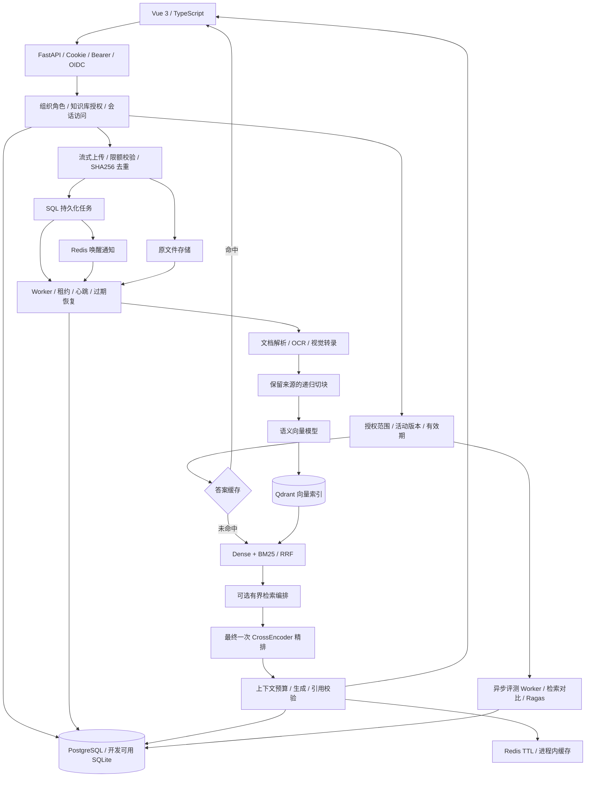
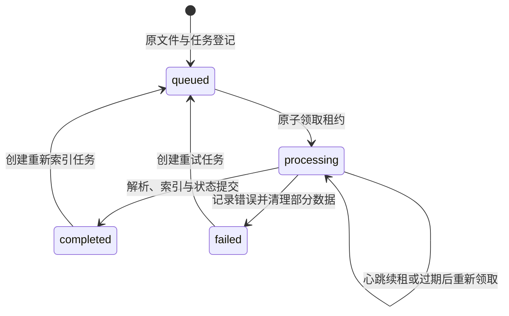

# 系统架构

拾意以文档为知识入口，以可追溯的证据组织回答，将知识库管理、异步摄取、混合检索、对话与评测连接为完整工作流。系统采用 FastAPI + Vue 架构，支持本地模型和 OpenAI 兼容服务，面向文档密集的私有知识管理场景。

设计目标与技术选型见[设计原则与技术参考](design.md)，运行方式见[部署指南](deployment.md)。

## 组件与数据流



API 负责账户、知识库、文档与对话接口；Worker 执行解析和索引任务；SQL 保存业务状态和来源文本；Qdrant 保存向量索引；Redis 提供任务唤醒和结果缓存。核心代码分别位于 [API 路由](../backend/app/api/routes.py)、[Worker](../backend/app/worker.py)、[服务层](../backend/app/services/)和 [Vue 页面](../frontend/src/App.vue)。

开发环境支持 SQLite、Qdrant local 与 API 内的摄取线程。生产配置使用 PostgreSQL、Redis、Qdrant server，并通过 [Compose](../docker-compose.yml)分开运行 API、Worker 和前端。

## 身份与知识范围

账户使用 PBKDF2-SHA256 密码与可撤销服务端会话。浏览器使用 HttpOnly Cookie，接口也支持显式 Bearer token。Cookie 请求执行来源与跨站标记检查；企业登录可接入 OIDC Authorization Code + PKCE。

知识库支持个人空间、组织全员可见和指定成员可见。组织成员及知识库授权分别提供管理员、编辑、只读角色。统一访问策略用于文档、检索、引用、历史与评测，移除成员或授权后不再提供其旧来源内容。

`CorpusScope` 在 SQL 中确定当前授权的活动版本及有效期。Qdrant 按允许知识库的 payload 过滤进行召回，SQL 再验证候选 chunk 的活动版本与有效性；词项检索在相同范围的倒排词频上计算 BM25。只有命中候选回查正文，不按全库分块列表构建请求过滤器。

版本切换和清理之间，向量服务可能暂时包含旧版本点；它们不能通过 SQL 候选验证。Dense 采用有界候选窗口，长期清理失败仍可能降低召回，因此需要监控清理任务并执行对账。授权与版本更新会改变缓存指纹，长模型调用完成后再次核对权限与会话状态。

## 文档生命周期

上传采用两层限额：ASGI 层限制 multipart 请求体，处理函数以 1 MiB 分块累计文件大小，默认接受不超过 50 MiB 的文件。原文件使用 UUID 路径保存，文件名保留为展示信息；下载与解析均校验路径处于 uploads 目录。SHA256 在知识库内去重，避免重复摄取。

[解析服务](../backend/app/services/parsing.py)支持 TXT、Markdown、CSV、JSON、HTML、PDF、DOCX、PNG、JPG/JPEG 和 WebP。文本兼容 UTF-8、GB18030 等编码；HTML 清理脚本与样式；DOCX 提取段落、表格及按配置启用的内嵌图片转录。切块默认使用 800 字符窗口、120 字符重叠，并保存文档 ID、页码和顺序。

PDF 保留实际页序号；含图像且需要转录的页面进入渲染、OCR 或视觉模型路径。OCR 使用 Tesseract 的 chi_sim、eng 语言包，视觉转录通过 Ollama 或 OpenAI 兼容模型完成，生成可检索的正文、表格和图表描述。

## 持久化任务与恢复

上传成功后先提交 Document 与 IngestionJob，再向 Redis 发送任务 ID。SQL 是任务状态的事实来源，Redis 用于唤醒消费者；通知丢失时，周期扫描仍可发现待处理任务。

Worker 通过条件 UPDATE 原子领取 queued 或租约过期的 processing 任务。领取成功后获得随机 lease_token，处理期间由心跳续租，终态写入再次校验 token，防止旧消费者覆盖后续执行结果。



默认每 2 秒扫描任务，租约为 600 秒，心跳不超过 15 秒。解析和 Embedding 不持有 SQL 写锁；向量批次写入使用短事务围栏，与删除和租约替换协调。新版本完成向量写入、SQL 分块和倒排词频后，在同一事务切换活动版本；失败时继续提供旧版。

文档删除在 SQL 事务中移除可见记录并保存 CleanupTask。外部向量和文件删除由 Worker 执行，失败后按退避重试，保留任务状态。旧版本索引回收保留原文件及版本元数据，恢复版本时重新建立索引。管理命令可对账孤立向量。

异步评测使用独立的持久运行状态和租约；Compose 分开运行摄取 Worker 与评测 Worker。Redis 的通知列表有长度和有效期限制，SQL 始终负责恢复任务。

## 混合检索与证据编排

Dense 检索使用 Qdrant cosine 相似度，生产查询使用入库时保存的 jieba 词频倒排，SQL 在授权活动版本内计算 BM25（k1=1.2、b=0.75、正 IDF）。内存 BM25Okapi 仅保留给独立小语料适配与测试。两路结果按 chunk ID 去重并进行 RRF 融合：

```text
RRF(chunk) = Σ 1 / (60 + rank_in_each_list)
```

返回结果分别保留 dense_score、bm25_score、retrieval_score 和可选的 rerank_score。RRF 表达多路排名的综合次序，CrossEncoder 表达查询与候选文本的匹配分；这些分数采用各自的尺度，不能换算为答案正确概率。

Agent 模式采用有界的证据补充流程：召回较宽候选，计算词项覆盖率，覆盖不足时进行关键词改写，再合并候选。各次补充召回跳过精排，最终统一调用一次 CrossEncoder 并截取 top_k。默认最多改写 2 次，代码硬上限为 3 次；词项覆盖率用于控制检索流程，复杂问题的处理效果通过评测观察。

CrossEncoder 由 RAG_RERANKER_MODEL 启用。该模式聚焦知识检索编排，不开放任意代码或通用外部工具执行。

## 对话、缓存与上下文预算

检索上下文读取最近 6 条历史消息，每条最多 1600 字符。短追问或带指代的问题会结合上一轮用户问题形成检索输入，让对话延续已有主题。

答案缓存键包含问题、模式、top_k、模型与接口、提示词版本、历史，以及当前允许知识库、语料代次和有效片段数量。语料更新或范围变化会改变缓存键。Redis 缓存按 TTL 过期；本地缓存最多保留 128 项，默认 TTL 为 3600 秒。命中结果通过 cached 与 usage 字段体现。

生成前，系统从 ollama_num_ctx 中扣除 max_output_tokens 和固定开销预留，以 UTF-8 字节数保守分配输入预算。发送历史进一步收缩为最近 4 条、每条 600 字节；证据按最终排名装入，末条可裁剪，引用正文与实际发送内容保持一致。超过问题及历史预算时返回明确错误。OpenAI 兼容服务也使用这一预算参数，应按所选模型的上下文窗口设置。

未配置生成模型时提供原文摘录模式；配置后通过 [LangChain 适配器](../backend/app/services/answering.py)调用模型。回答使用 [n] 来源编号，越界编号被清除；没有有效引用的非拒答输出退回原文摘录。数字校验和可选 LLM 核验进一步检查事实支持；证据不足则拒答。实时 SSE 传输供应商草稿，核验后的结果作为唯一完成消息持久化。

## 模型与存储配置

系统支持 Ollama、SentenceTransformers 和 OpenAI 兼容向量服务。Qdrant 集合名称包含向量配置指纹，向量维度变化后需要重新索引。数据访问配置通过环境变量提供，模型参数与业务代码分离。

| 配置项 | Ollama 部署示例 |
| --- | --- |
| 对话与视觉模型 | qwen3.5:9b |
| 向量模型 | qwen3-embedding:8b |
| 向量维度 | 4096 |
| 向量请求上下文 | 4096 |
| 对话上下文 / 最大输出 | 16384 / 2048 |
| 服务隔离 | 独立 SQL 数据库、Redis 数据库与 Qdrant 集合前缀 |

模型与依赖安装方式见[部署指南](deployment.md)。仓库中的[模型适配验证记录](artifacts/model-adapters-2026-10-16.json)记录了 CrossEncoder 实际推理与视觉转录检查。

## 评测闭环

[评测服务](../backend/app/services/evaluation.py)根据 expected_document_ids 计算 Hit@5、Recall@5 和 MRR@5，并支持在同一标注集上对比 dense 与 hybrid。相关性以文档为单位，top-5 槽位按检索片段排序计算。reference_token_recall 提供参考答案词项覆盖信息。

启用 Ragas 后，系统使用真实生成模型、语义向量及 reference 计算 faithfulness、answer_relevancy、context_precision、context_recall。依赖和配置在调用前校验，评测结果、失败状态与错误均持久化保存。

历史评测通过 message_id 读取当前账户的已保存答案与引用，支持对同一回答反复评估；实时检索评测用于观察当前语料与配置。Ragas 判断缓存包含问题、答案、上下文、reference、模型与协议版本，只保存四项均有效的分数，并记录 judge_cached_cases、judge_scored_cases。评测执行采用单并发及有界超时、重试，控制模型资源占用。

## 治理、可观测性与发布

SQL 原子计数和过期并发槽实现跨 API 副本的限流、容量与请求预算。问答有请求幂等键及会话租约，消息记录提示词、模型配置、来源版本、实际用量、核验结果与阶段耗时。审计只保存操作人与资源标识，不记录密码、令牌或文档正文。

`/api/health` 用于进程存活，`/api/ready` 检查 SQL、Redis、Qdrant 和 Worker 心跳，`/api/ready/models` 提供受登录保护的模型 API 探针。受独立凭证保护的 Prometheus 端点导出请求、阶段耗时、队列与恢复指标。HTTP 请求关联 ID 与生成运行元数据可以关联排障。

Alembic 接管原有表结构并保留原分块 ID，将已有内容迁移为来源版本和持久倒排。Compose 先完成迁移，再启动应用与 Worker。离线维护命令协调 SQL、文件和向量快照，使用校验清单、空目标保护以及恢复后查询验证。

完整操作与边界见[团队治理与可靠性](enterprise.md)和[部署指南](deployment.md)。
