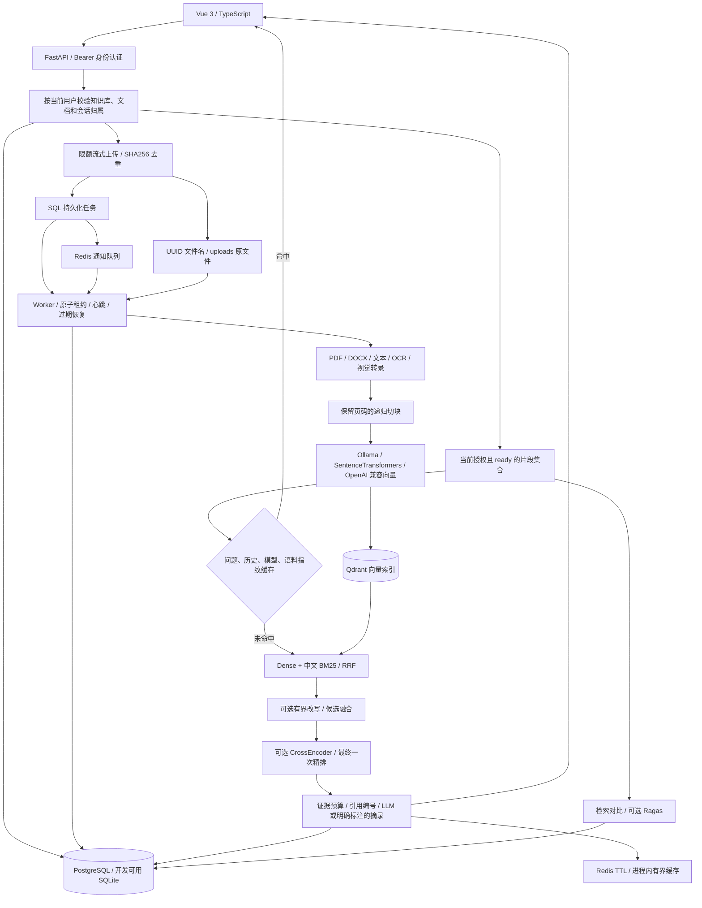
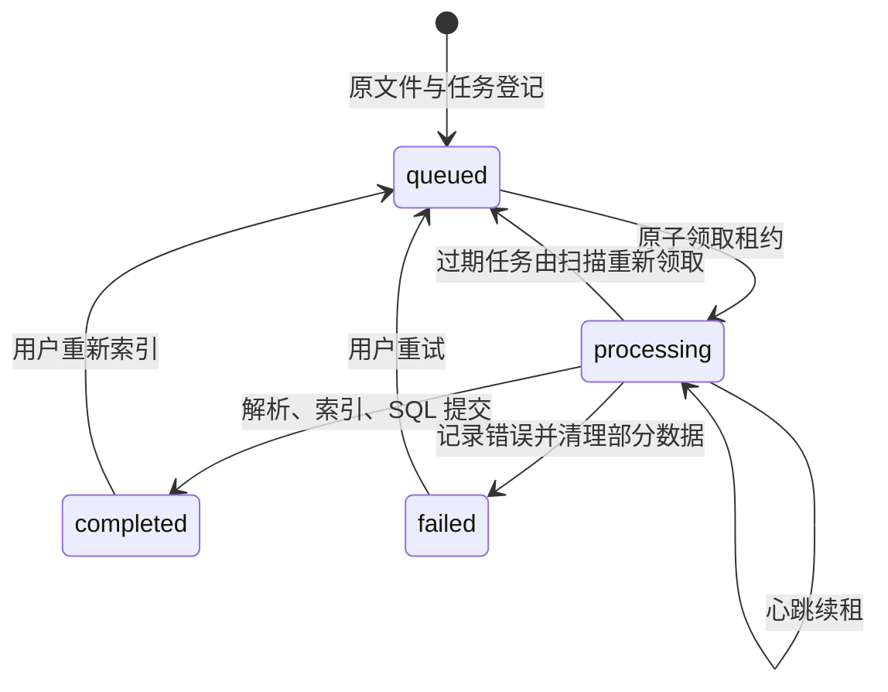

# 知衡的运行架构与边界

本文记录当前代码实现，更新于 2026-10-15。项目把截图要求的文档摄取、混合检索、多模态与评测闭环，结合 KnowAgenticRAG 的有界检索编排思路，独立实现为 FastAPI + Vue 应用。功能与参考来源的逐项映射见[需求与来源说明](requirements-and-provenance.md)。

## 一次请求经过哪些组件



开发模式不配置 Redis 时，API 启动一个本地摄取线程；配置 Redis 后需单独运行 Worker。生产配置要求 PostgreSQL、Redis 和 Qdrant server；Compose 分开运行 API、Worker 与前端。不能用多个进程同时打开同一个 Qdrant local 路径。

核心入口是 [API 路由](../backend/app/api/routes.py)、[摄取 Worker](../backend/app/worker.py)、[服务层](../backend/app/services/)和 [Vue 页面](../frontend/src/App.vue)。数据库模型在 [models.py](../backend/app/models.py)，部署编排在 [docker-compose.yml](../docker-compose.yml)。

## 身份、检索范围与不可信内容

账户密码使用带随机盐的 PBKDF2-SHA256；服务签发有过期时间的 HMAC Bearer token。生产模式拒绝开发默认密钥。当前权限模型是用户拥有自己的知识库，不包含部门共享或团队角色继承。

每次查询先由 SQL 验证所选知识库归属。空知识库列表表示当前用户的全部知识库；传入不属于当前账户的 ID 返回 404。SQL 只加载当前用户且文档状态为 ready 的片段，Qdrant 再通过 HasIdCondition 把这些片段对应的 point ID 作为排名前过滤条件，BM25 也只对同一个授权语料集合计算。API 返回前再次检查引用 chunk ID。权限逻辑见 [scoped_chunks](../backend/app/api/routes.py)和 [retrieve](../backend/app/services/retrieval.py)。

文件名只用于展示，原文件使用 UUID 路径保存；下载和 Worker 都检查解析后的路径处于 uploads 目录。上传在 ASGI 层限制整个 multipart 请求，处理函数再以 1 MiB 分块累计文件大小；文件上限默认 50 MiB。SHA256 在知识库内去重，同一文件在不同账户知识库中可以独立保存。

上传文档、OCR 结果、视觉转录和对话历史都属于不可信数据。生成时系统规则与 sources 分开，文档内的指令只作为待引用内容。历史从已校验归属的服务端会话读取，只接受 user、assistant 角色。提示词约束和引用编号检查有助于防止错误引用，不能证明每句话均由证据蕴含，也不能承诺完全消除提示注入或幻觉。

## SQL 任务是摄取事实来源

上传成功先提交 Document 与 IngestionJob，再向 Redis 放入任务 ID。因此 Redis 通知丢失时，SQL 扫描仍能发现 queued 任务。Worker 对 queued 或租约过期的 processing 任务执行条件 UPDATE，只有成功更新一行的消费者获得随机 lease_token；处理期间心跳续租，终态写入也校验 token，避免旧消费者覆盖新消费者结果。



图中的“过期后重新领取”是逻辑恢复：代码可以直接重新领取过期的 processing 记录，不必先持久化为 queued。租约与 attempts 字段用于恢复和审计；这不是跨 SQL、文件系统与 Qdrant 的分布式事务，也不保证任务只执行一次。失败路径清理部分 SQL/向量数据，删除与索引使用数据库写入协调；进程或外部服务在关键时刻中断仍需结合任务状态检查并重试。

默认配置每 2 秒扫描，租约 600 秒，心跳间隔不超过 15 秒。值以 [Settings](../backend/app/config.py) 为准。文档与任务状态、进度和失败原因可通过文档列表及 /api/jobs/{id} 查看。

## 解析与来源定位

[parsing.py](../backend/app/services/parsing.py)支持 TXT、Markdown、CSV、JSON、HTML、PDF、DOCX、PNG、JPG/JPEG 和 WebP。文本兼容 UTF-8、GB18030 等编码；HTML 移除脚本和样式；DOCX 提取段落与表格。文本以递归分隔器切块，默认 800 字符、重叠 120 字符，并保留文档 ID、片段顺序及页码。

PDF 使用实际页序号。文本页中的空白页或短标题不会仅因字符少而强制 OCR；存在图像且需要转录时，渲染页面再交给 OCR/视觉模型。OCR 依赖 Tesseract 的 chi_sim 与 eng 语言包；视觉路径支持 Ollama 或 OpenAI 兼容接口上的 Qwen-VL 等模型。配置视觉能力时也可提取 DOCX 内嵌图片。渲染和转录是有额外资源开销的功能，所需模型与运行依赖必须实际可用。

DOCX 没有稳定的物理页信息；当前返回 page=1，表示逻辑文本区域，不能解释为 Word 或打印后的第 1 页。CSV、Markdown、独立图片等也使用逻辑页。需要物理页定位时应先转换为 PDF。

## 混合检索和有界 Agent

Dense 检索使用 Qdrant cosine 相似度。稀疏检索使用 jieba 中文分词和 BM25Okapi；对小语料中的非正 IDF 使用正值下限，避免一两篇文档时相关词无法形成正匹配。Dense 与 BM25 分别召回后，以 chunk ID 去重，通过 RRF 合并排序：

```text
RRF(chunk) = Σ 1 / (60 + rank_in_each_list)
```

RRF 是排名融合分，dense_score 是向量相似度，bm25_score 是词项相关分；可选 rerank_score 是 CrossEncoder 输出。它们不共享量纲，不应把 RRF 的 0.03 当成“3% 置信度”，也不能直接复用余弦阈值判断答案可靠程度。API 分开保存这些分数。

Agent 模式是服务端控制的证据补充循环：先召回较宽的候选，计算词项覆盖率，覆盖不足时做确定性的关键词改写；每次改写召回不执行精排，候选合并后最终只做一次 CrossEncoder，再截取 top_k。默认最多改写 2 次，代码硬上限 3 次。覆盖率只是一种启发式，不是正确率、语义充分性评分或 Ragas 分数。此模式没有通用工具执行、任意代码运行或额外的规划 LLM 调用。

CrossEncoder 仅在设置 RAG_RERANKER_MODEL 且相应依赖、模型可用时启用。首次模型下载和本机推理成本应单独计算；当前不把“启用配置”当成“完成质量验证”。

## 历史、缓存与模型预算

会话由当前账户拥有。生成服务对历史限定为最近 6 条消息，每条最多 1600 字符；短追问或“它、上述、继续”等指代问题会结合上一轮用户问题形成检索上下文。该规则不等同于完整的指代消解。

答案缓存键包括问题、模式、top_k、模型/接口、提示词版本、实际使用的历史，以及当前全部授权片段的 ID、文档名、页码与正文。修改语料或切换授权范围会改变键，旧答案不会被新的请求直接复用。Redis 使用 TTL；无 Redis 或 Redis 读写失败时有进程内缓存，最多 128 项、默认 TTL 3600 秒。命中时返回 cached=true、model_calls=0。缓存不会推断或承诺固定的成本下降比例。

生成前还会执行证据预算：以 ollama_num_ctx 减去 max_output_tokens 和 1800 的固定开销预留，用 UTF-8 字节数近似约束输入。发送给模型的历史进一步限制为最近 4 条、每条 600 字节，片段按最终排名依次装入，最后一条可裁剪；引用内容与实际发送的裁剪后正文保持一致。问题与历史已经超过可用预算时返回可操作的错误。该策略偏保守，字节数不是所选模型分词器的精确 token 计数；非 Ollama 接口也应把 ollama_num_ctx 配为实际上下文窗口上限。实现见 [answering.py](../backend/app/services/answering.py)及 [Settings](../backend/app/config.py)。

模型未配置时返回明确标注的原文摘录；hash embedding 只供离线链路演示，不代表语义检索。模型回答必须使用有效 [n] 引用编号，编号越界会清除；没有有效引用时退回摘录。使用真实模型也应通过评测检查证据充分性。

## 本机 Ollama 配置

用户指定的 Python 环境为 cook-rag-1。本机复用配置由 [configure-local.py](../scripts/configure-local.py)读取相邻 code_c8 项目的环境变量，生成当前项目不入库的 .env；文档不记录任何实际连接凭据。

| 项目 | 本机配置 |
| --- | --- |
| 对话与视觉转录模型 | Ollama qwen3.5:9b |
| 语义向量模型 | Ollama qwen3-embedding:8b |
| 向量维度 | 4096；与向量请求上下文长度是不同概念 |
| 向量请求上下文 | 默认 4096，按批次请求并检查返回维度 |
| 对话上下文 / 最大输出 | 默认 16384 / 2048 |
| 数据隔离 | 独立 PostgreSQL 数据库 rag_knowledge_assistant、Redis DB 6、Qdrant rag_assistant_* 集合 |

该配置说明模型适配路径，不代表已经测得特定延迟、显存占用、Ragas 质量或相对提升。通过脚本生成的凭据配置与运行数据不能提交到 Git。

## 评测与当前限制

[evaluation.py](../backend/app/services/evaluation.py)提供基于人工 expected_document_ids 标注的 Hit@5、Recall@5 和 MRR@5，以及 dense 与 hybrid 的相同语料对比。命中以文档为相关性单位，排序槽位仍来自片段；多个片段来自同一文档会占用多个 top-5 槽位。reference_token_recall 只是词项重叠，不冒充 answer_relevancy 或 faithfulness。

显式开启 Ragas 且具备真实模型、语义向量、reference 和 evaluation 依赖时，才计算 faithfulness、answer_relevancy、context_precision、context_recall。前置条件在检索与生成前校验，失败保留失败状态和错误，不能以零分或虚构分数代替未执行。

评测案例可以指定当前账户历史助手消息的 message_id，复用当时的问题、答案与引用，避免再次生成答案；服务端校验历史消息归属。这是对原答案的回放评测，不能冒充更新语料后的重新检索效果。Ragas 判断另有缓存，键包含问题、答案、上下文、reference、评审及向量模型/接口、评测协议版本；只缓存四项均有效的分数，并报告 judge_cached_cases 与 judge_scored_cases。实际执行使用单并发、受配置超时和重试上限约束，保护本机模型资源。

没有真实模型条件的离线自动化测试只验证行为，不验证模型判断质量。测试入口为 [test_api.py](../backend/tests/test_api.py)与 [test_services.py](../backend/tests/test_services.py)，可在项目根目录运行 scripts/dev.ps1 -Service test。

当前边界：

- /api/chat/stream 在完整答案生成并入库后回放 SSE sources、trace、token、done；它不提供供应商逐 token 的实时推理流。
- 数据表使用 SQLAlchemy create_all 初始化，没有 Alembic 迁移历史；升级现有结构前需要迁移方案和备份。
- 用户隔离不等于团队 RBAC、文档共享 ACL、SSO 或完整企业审计。
- BM25 每次请求对授权片段在内存中重建，SQL 加载整个候选正文；Qdrant 过滤传入全部授权 chunk ID。该实现适合本机与中小语料验证，未进行百万片段规模压测。
- 评测接口同步运行；重启后处理过期 running 记录不能替代完整的评测作业调度。
- 自动化测试、真实模型联调、Docker 整栈测试、质量基准应分别记录，不因代码存在而视为全部通过。项目没有把截图中的“命中提升 20%”或“成本降低 30%”写成实测结论。
