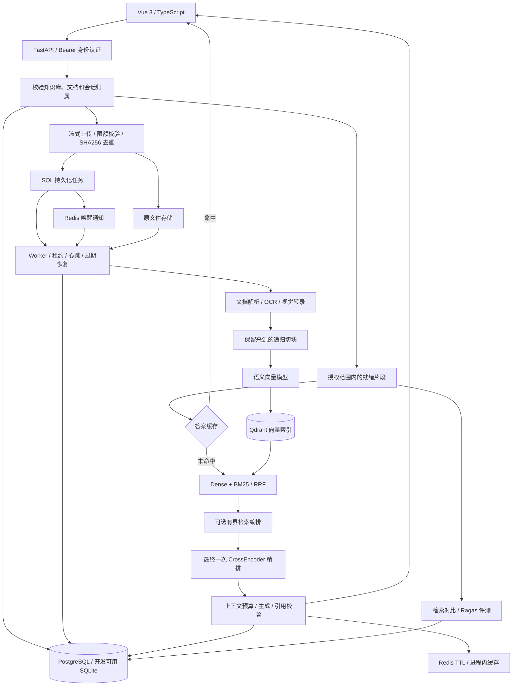
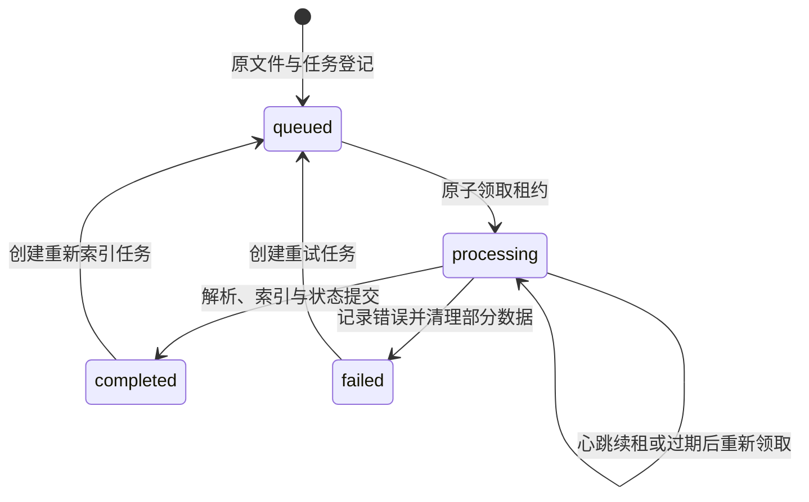

# 系统架构

知衡以文档为知识入口，以可追溯的证据组织回答，将知识库管理、异步摄取、混合检索、对话与评测连接为完整工作流。系统采用 FastAPI + Vue 架构，支持本地模型和 OpenAI 兼容服务，面向文档密集的私有知识管理场景。

设计目标与技术选型见[设计原则与技术参考](design.md)，运行方式见[部署指南](deployment.md)。

## 组件与数据流



API 负责账户、知识库、文档与对话接口；Worker 执行解析和索引任务；SQL 保存业务状态和来源文本；Qdrant 保存向量索引；Redis 提供任务唤醒和结果缓存。核心代码分别位于 [API 路由](../backend/app/api/routes.py)、[Worker](../backend/app/worker.py)、[服务层](../backend/app/services/)和 [Vue 页面](../frontend/src/App.vue)。

开发环境支持 SQLite、Qdrant local 与 API 内的摄取线程。生产配置使用 PostgreSQL、Redis、Qdrant server，并通过 [Compose](../docker-compose.yml)分开运行 API、Worker 和前端。

## 身份与知识范围

账户密码使用带随机盐的 PBKDF2-SHA256；服务签发带有效期的 HMAC Bearer token。生产配置校验签名密钥，拒绝开发默认值。

查询范围从 SQL 中确定：服务先校验所选知识库归属，再加载当前用户且文档状态为 ready 的片段。空知识库列表表示该账户的全部知识库。Qdrant 使用 HasIdCondition 在排名前限制可参与检索的 point ID；BM25 使用相同的授权片段集合。API 返回前再次核对引用 chunk ID，使向量召回、词项召回和答案引用使用一致的范围。实现见 [scoped_chunks](../backend/app/api/routes.py)与 [retrieve](../backend/app/services/retrieval.py)。

系统规则与 sources 分开传递，文档、OCR、视觉转录及历史消息均作为数据处理。会话历史从服务端读取并校验归属，只保留 user、assistant 角色；引用编号检查用于保持回答与来源之间的对应关系。

## 文档生命周期

上传采用两层限额：ASGI 层限制 multipart 请求体，处理函数以 1 MiB 分块累计文件大小，默认接受不超过 50 MiB 的文件。原文件使用 UUID 路径保存，文件名保留为展示信息；下载与解析均校验路径处于 uploads 目录。SHA256 在知识库内去重，避免重复摄取。

[解析服务](../backend/app/services/parsing.py)支持 TXT、Markdown、CSV、JSON、HTML、PDF、DOCX、PNG、JPG/JPEG 和 WebP。文本兼容 UTF-8、GB18030 等编码；HTML 清理脚本与样式；DOCX 提取段落、表格及按配置启用的内嵌图片转录。切块默认使用 800 字符窗口、120 字符重叠，并保存文档 ID、页码和顺序。

PDF 保留实际页序号；含图像且需要转录的页面进入渲染、OCR 或视觉模型路径。OCR 使用 Tesseract 的 chi_sim、eng 语言包，视觉转录通过 Ollama 或 OpenAI 兼容模型完成，生成可检索的正文、表格和图表描述。

## 持久化任务与恢复

上传成功后先提交 Document 与 IngestionJob，再向 Redis 发送任务 ID。SQL 是任务状态的事实来源，Redis 用于唤醒消费者；通知丢失时，周期扫描仍可发现待处理任务。

Worker 通过条件 UPDATE 原子领取 queued 或租约过期的 processing 任务。领取成功后获得随机 lease_token，处理期间由心跳续租，终态写入再次校验 token，防止旧消费者覆盖后续执行结果。



默认每 2 秒扫描任务，租约为 600 秒，心跳间隔不超过 15 秒，具体参数见 [Settings](../backend/app/config.py)。任务状态、进度和错误通过文档列表及 /api/jobs/{id} 提供。失败路径清理部分 SQL 与向量数据，删除和索引通过数据库写入协调。

## 混合检索与证据编排

Dense 检索使用 Qdrant cosine 相似度，词项检索使用 jieba 分词和 BM25Okapi。小语料中的非正 IDF 使用正值下限，使少量文档也能形成有效词项匹配。两路结果按 chunk ID 去重并进行 RRF 融合：

```text
RRF(chunk) = Σ 1 / (60 + rank_in_each_list)
```

返回结果分别保留 dense_score、bm25_score、retrieval_score 和可选的 rerank_score。RRF 表达多路排名的综合次序，CrossEncoder 表达查询与候选文本的匹配分；这些分数采用各自的尺度，不能换算为答案正确概率。

Agent 模式采用有界的证据补充流程：召回较宽候选，计算词项覆盖率，覆盖不足时进行关键词改写，再合并候选。各次补充召回跳过精排，最终统一调用一次 CrossEncoder 并截取 top_k。默认最多改写 2 次，代码硬上限为 3 次；词项覆盖率用于控制检索流程，复杂问题的处理效果通过评测观察。

CrossEncoder 由 RAG_RERANKER_MODEL 启用。该模式聚焦知识检索编排，不开放任意代码或通用外部工具执行。

## 对话、缓存与上下文预算

检索上下文读取最近 6 条历史消息，每条最多 1600 字符。短追问或带指代的问题会结合上一轮用户问题形成检索输入，让对话延续已有主题。

答案缓存键包含问题、模式、top_k、模型与接口、提示词版本、历史，以及授权语料的片段 ID、文档名、页码与正文。语料更新或范围变化会改变缓存键。Redis 缓存按 TTL 过期；本地缓存最多保留 128 项，默认 TTL 为 3600 秒。命中结果通过 cached 与 usage 字段体现。

生成前，系统从 ollama_num_ctx 中扣除 max_output_tokens 和固定开销预留，以 UTF-8 字节数保守分配输入预算。发送历史进一步收缩为最近 4 条、每条 600 字节；证据按最终排名装入，末条可裁剪，引用正文与实际发送内容保持一致。超过问题及历史预算时返回明确错误。OpenAI 兼容服务也使用这一预算参数，应按所选模型的上下文窗口设置。

未配置生成模型时提供原文摘录模式；配置后通过 [LangChain 适配器](../backend/app/services/answering.py)调用模型。回答使用 [n] 来源编号，越界编号被清除；没有有效引用的输出退回原文摘录。

## 模型与存储配置

系统支持 Ollama、SentenceTransformers 和 OpenAI 兼容向量服务。Qdrant 集合名称包含向量配置指纹，向量维度变化后需要重新索引。数据访问配置通过环境变量提供，模型参数与业务代码分离。

| 配置项 | Ollama 部署示例 |
| --- | --- |
| 对话与视觉模型 | qwen3.5:9b |
| 向量模型 | qwen3-embedding:8b |
| 向量维度 | 4096 |
| 向量请求上下文 | 4096 |
| 对话上下文 / 最大输出 | 16384 / 2048 |
| 服务隔离 | 独立 SQL 数据库、Redis 数据库与 Qdrant 集合前缀 |

模型与依赖安装方式见[部署指南](deployment.md)。仓库中的[模型适配验证记录](artifacts/model-adapters-2026-10-16.json)记录了 CrossEncoder 实际推理与视觉转录检查。

## 评测闭环

[评测服务](../backend/app/services/evaluation.py)根据 expected_document_ids 计算 Hit@5、Recall@5 和 MRR@5，并支持在同一标注集上对比 dense 与 hybrid。相关性以文档为单位，top-5 槽位按检索片段排序计算。reference_token_recall 提供参考答案词项覆盖信息。

启用 Ragas 后，系统使用真实生成模型、语义向量及 reference 计算 faithfulness、answer_relevancy、context_precision、context_recall。依赖和配置在调用前校验，评测结果、失败状态与错误均持久化保存。

历史评测通过 message_id 读取当前账户的已保存答案与引用，支持对同一回答反复评估；实时检索评测用于观察当前语料与配置。Ragas 判断缓存包含问题、答案、上下文、reference、模型与协议版本，只保存四项均有效的分数，并记录 judge_cached_cases、judge_scored_cases。评测执行采用单并发及有界超时、重试，控制模型资源占用。

## 设计取舍与扩展方向

| 当前实现 | 扩展方向 |
| --- | --- |
| DOCX、文本和独立图片使用逻辑页；DOCX page=1 | 需要物理页定位时转换为 PDF，或引入布局解析器 |
| SSE 在完整答案生成入库后回放 sources、trace、token、done | 接入供应商原生流式协议，缩短首段内容等待时间 |
| SQLAlchemy create_all 初始化数据表 | 为持续版本升级引入 Alembic 迁移与回滚流程 |
| 账户拥有知识库，检索按账户隔离 | 增加组织、团队 RBAC、共享 ACL 与 SSO |
| BM25 在请求内重建，SQL 加载授权片段，Qdrant 按片段 ID 过滤 | 面向更大语料建立持久化稀疏索引与服务端范围过滤 |
| SQL 租约恢复与失败清理协调多个存储 | 增加跨存储对账、故障演练与更多运行指标 |
| 同步评测接口及持久化运行结果 | 为大批量评测引入独立作业调度 |
| 字节预算、词项覆盖率和引用编号校验 | 增加模型分词器预算与语义证据校验 |

自动化测试见 [test_api.py](../backend/tests/test_api.py)与 [test_services.py](../backend/tests/test_services.py)。检索质量、模型判断、缓存收益和运行容量分别使用对应数据集与环境评估，便于比较不同模型、语料和部署配置。
